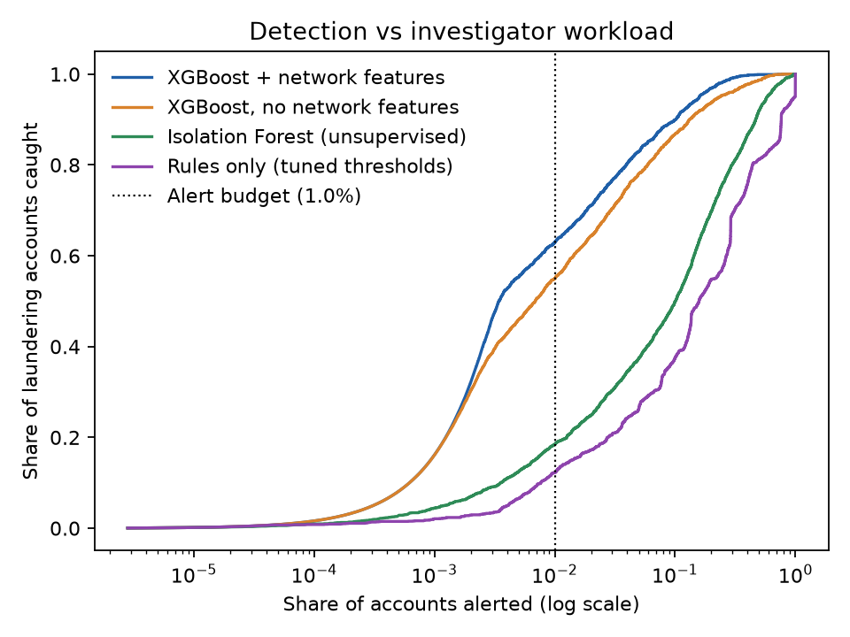
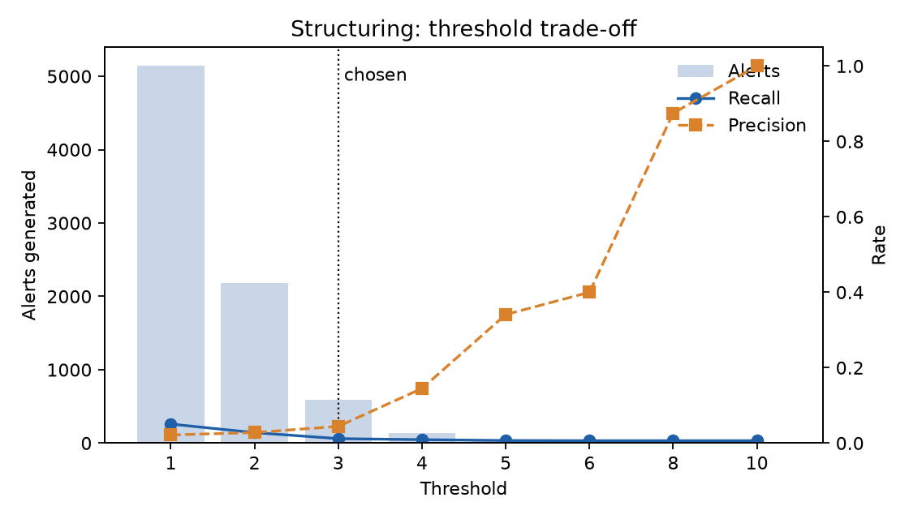

# AML Transaction Monitoring: Rules, Network Analysis and ML

An account-level anti-money-laundering transaction monitoring prototype, built the way a bank's monitoring team works:

1. **Rule scenarios** for known typologies: structuring, rapid movement of funds, fan-in/fan-out.
2. **Threshold tuning** against an investigator alert budget, with **below-the-line testing**.
3. **Network analysis** of the account graph: PageRank, Louvain communities, reciprocity, directed 3-cycles.
4. **Supervised and unsupervised models** (XGBoost, Isolation Forest) compared with rules on alert workload.
5. A **model white paper** documenting data, methodology, thresholds, limitations and monitoring.

> Data is synthetic (IBM AML dataset, HI-Small). No real customer data is used.

## Results

<!-- After running the pipeline, paste the key rows of reports/model_comparison_test.csv here
     and embed 2-3 charts:


-->

## Quick start

```bash
python -m venv .venv
.venv\Scripts\activate            # Windows   (macOS/Linux: source .venv/bin/activate)
pip install -r requirements.txt
pytest -q                          # synthetic smoke test, about 1 minute
```

1. Download `HI-Small_Trans.csv` from the Kaggle dataset **IBM Transactions for Anti Money Laundering (AML)** and place it in `data/raw/`.
2. Do a quick development run on part of the data:
   ```bash
   python scripts/run_pipeline.py --nrows 500000
   ```
3. Then the full run:
   ```bash
   python scripts/run_pipeline.py
   ```
4. Open `reports/resume_bullets.md`. Your resume bullets are pre-filled with your actual numbers.
5. Fill in `docs/model_white_paper.md` from `reports/`.

Runs on CPU; no GPU needed. On a Kaggle notebook, set `data.raw_csv` in `config.yaml` to the `/kaggle/input/...` path.

## Repository layout

```
config.yaml               every threshold, grid and model parameter
scripts/run_pipeline.py   end-to-end run -> reports/
src/aml/
  data.py                 load, clean, FX to USD (rates derived from the data), time split, labels
  scenarios.py            structuring, rapid movement, fan-in/out scores
  tuning.py               threshold sweeps, budget-based selection, below-the-line testing
  features.py             account-level behavioural features
  graph_features.py       network features (NetworkX + sparse matrices)
  models.py               XGBoost, Isolation Forest, rules baseline
  evaluate.py             PR-AUC, recall at alert budget, alerts needed for target recall
  viz.py                  manager-facing charts
  report.py               resume bullets from results.json
notebooks/01_eda.py       exploratory analysis (cell-based script)
docs/model_white_paper.md white paper template
tests/                    synthetic-data tests
```

## Design choices

- **Account-level, not transaction-level:** monitoring teams alert on customers and accounts, not single payments.
- **Equal-size chronological windows:** the timeline is cut into 5 windows with equal transaction counts (3 train, 1 validation, 1 test). Count-based features and rule scores then mean the same thing in every period. In v1, the training period was 3x larger than test, so thresholds tuned on it did not transfer.
- **Thresholds tuned on validation,** a window the same size as test, then checked with below-the-line testing on test.
- **Model selection:** XGBoost random search on validation PR-AUC, then a refit on train + validation. Rerun with `--reuse-search` to skip the search; window features are cached in `reports/cache/`.
- **Durability evidence:** 95% bootstrap CIs, paired bootstrap tests (model vs rules, with vs without network features), seed reruns, validation-vs-test stability of a train-only model, and PSI drift per feature. A feature with severe drift and no performance value is dropped (`models.drop_features`).
- **Workload-based metrics:** results are reported as recall at a fixed alert budget, and alerts needed to reach a target recall. Accuracy is meaningless at a laundering rate near 0.1%.
- **Explainable features:** every feature maps to a behaviour an investigator would recognise.

## Running on a cloud GPU (RunPod)

`RUNPOD.md` is the step-by-step guide: choosing a pod, starting it, running everything with `bash runpod/start.sh`, downloading results and terminating the pod. The scripts in `runpod/` work on any Linux GPU machine.

## GNN experiment on Kaggle (larger data, GPU)

`scripts/run_gnn.py` trains a directional GraphSAGE network (plain PyTorch) on the same time windows as the pipeline. It compares the GNN, XGBoost and a 50/50 rank ensemble on the same test accounts, with a paired bootstrap. Its resume draft (`gnn/resume_bullets_gnn.md`) claims a GNN gain only if the gain is significant.

Run it on Kaggle with `kaggle/aml_gnn_kaggle.ipynb`:
1. Create a Kaggle notebook, then *File → Import notebook* and choose `kaggle/aml_gnn_kaggle.ipynb`.
2. *Add data*: "IBM Transactions for Anti Money Laundering (AML)".
3. Add the code: push this repo to GitHub and set `REPO_URL`, or upload the folder (without `data/`) as a Kaggle dataset.
4. Accelerator: GPU T4 x2 or P100. Do a first run with `DATASET = "HI-Small"` (about 30-40 min), then `"HI-Medium"` (about 31M transactions, 2-3 hours) via *Save & Run All*.
5. Download `aml_results_<dataset>.zip` from the Output panel.

If a run stops (e.g. killed for memory), rerun the same cell: window features, the hyperparameter search, the round search and every finished model stage are checkpointed in `/kaggle/working` and reused within the same session. Each progress line shows peak RAM, so the step that failed is visible. If memory is still short, set `MAX_TRAIN_WINDOWS` (e.g. 15) to train on the most recent windows only.

Locally: `pip install torch`, then `python scripts/run_gnn.py` after `run_pipeline.py`. This is slow on a CPU for the full data.

## Experiments that did not help

| Version | Change | Test PR-AUC | Result |
|---|---|---|---|
| v1 | Baseline | 0.31 | |
| v2 | Equal windows, new features, tuning, drift fix | **0.63** | Kept |
| v3 | Prior-case history features (2-window label lag) | 0.62 | Dropped: significantly worse PR-AUC; only one training window had history, so the model overfit it |
| v3 | Boosting-round cap 600 to 2000 | 0.63 | No change; the best count was about 600-700 |
| HI-Medium | Same pipeline on 31.9M transactions + GraphSAGE GNN (RunPod GPU) | 0.90 XGBoost, 0.91 GNN, 0.92 ensemble* | Network features +10 recall pts; GNN +0.7 pts over XGBoost (significant on test, not ahead on validation). XGBoost kept as primary. Results in `reports/hi_medium/`; see white paper Section 8 |

\*The HI-Medium test window is unusually long (12 days) with 3x the laundering base rate of validation, so its absolute scores run high. Compare models within it, not against HI-Small.

Details: `reports/experiments/v3_case_history/`. The history code stays in `src/aml/history.py`, switched off in `config.yaml`. Negative results are part of the model record and belong in the white paper.

## 7-day plan

| Day | Work |
|---|---|
| 1 | Set up the environment, pass the tests, download data, run the EDA notebook |
| 2 | Quick run with `--nrows 500000`; sanity-check scenario scores and sweeps |
| 3 | Full run; adjust threshold grids in `config.yaml` if the sweeps are flat |
| 4 | Review model comparison and feature importance; try one improvement |
| 5 | Write the white paper |
| 6 | README results section, charts, clean up the repo, push to GitHub |
| 7 | Copy bullets into the resume; prepare a 2-minute walkthrough for interviews |
