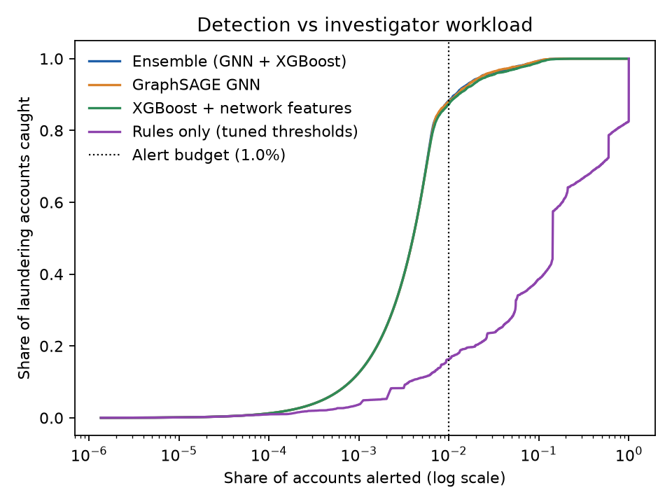

# AML Transaction Monitoring: Rules, Network Analysis and ML

An account-level anti-money-laundering (AML) transaction monitoring prototype, built the way a bank's monitoring team works:

1. **Rule scenarios** for known typologies: structuring, rapid movement of funds, fan-in/fan-out.
2. **Threshold tuning** against an investigator alert budget, checked with **below-the-line testing**.
3. **Network analysis** of the account graph: PageRank, Louvain communities, reciprocity, directed 3-cycles, counterparty aggregates.
4. **Supervised and unsupervised models** (XGBoost, Isolation Forest) compared with rules on investigator workload.
5. A **graph neural network** (directional GraphSAGE, PyTorch) benchmarked against XGBoost at scale (31.9M transactions, cloud GPU).
6. A **[model white paper](docs/model_white_paper.md)** covering data quality, methodology, threshold rationale, rejected alternatives, limitations and a monitoring plan.

> All data is synthetic: IBM's *Realistic Synthetic Financial Transactions for Anti-Money Laundering Models* (HI-Small and HI-Medium). No real customer data is used.

## Results

Investigators can review a fixed number of accounts, so every model is judged on the same **1% alert budget**: of the accounts it flags, how many laundering accounts does it catch?

### HI-Small: 5.1M transactions (held-out test window: 356K accounts, 0.6% laundering)

| Model | Recall at 1% budget | Precision at 1% budget | PR-AUC |
|---|---|---|---|
| **XGBoost + network features** | **63.0%** (95% CI 61.1-65.0%) | **38.9%** | **0.629** |
| XGBoost, no network features | 55.1% | 34.0% | 0.518 |
| Isolation Forest (unsupervised) | 18.5% | 11.4% | 0.072 |
| Rules only, tuned thresholds | 12.3% | 7.6% | 0.036 |

For the same investigator workload, the model catches **5x as many laundering accounts as the rules**. Network features add 8 recall points. Both gaps are significant in a paired bootstrap.


### HI-Medium: 31.9M transactions on a cloud GPU (test window: 738K accounts)

| Model | Recall at 1% budget | Precision at 1% budget | PR-AUC |
|---|---|---|---|
| **Ensemble (GNN + XGBoost)** | **88.4%** | **70.3%** | **0.915** |
| GraphSAGE GNN | 88.2% | 70.1% | 0.912 |
| XGBoost + network features | 87.4% | 69.4% | 0.905 |
| XGBoost, no network features | 77.5% | 61.6% | 0.804 |
| Isolation Forest (unsupervised) | 24.2% | 19.2% | 0.133 |
| Rules only, tuned thresholds | 16.3% | 13.0% | 0.070 |

- **Network features add about 10 recall points.** This confirms the HI-Small finding at 6x the data.
- **The GNN beats XGBoost by 0.7 points and the ensemble by 1.0 point.** Both gains are significant, but the GNN did not lead on the validation window. XGBoost stays the primary model because it is easier to explain; the ensemble is kept as a challenger.
- **This test window is unusually easy.** It spans 12 days and has a laundering rate 3x that of validation, which lifts absolute scores. Compare models within this table, not against HI-Small. Details: [white paper, Section 8](docs/model_white_paper.md).



## Quick start (HI-Small, CPU)

```bash
python -m venv .venv
.venv\Scripts\activate            # Windows   (macOS/Linux: source .venv/bin/activate)
pip install -r requirements.txt
pytest -q                          # synthetic-data tests, under a minute
```

1. Download `HI-Small_Trans.csv` from the Kaggle dataset **IBM Transactions for Anti Money Laundering (AML)** into `data/raw/`.
2. Do a quick run on part of the data: `python scripts/run_pipeline.py --nrows 500000`
3. Then the full run: `python scripts/run_pipeline.py`. Results, charts and `summary.md` go to `reports/`.

For HI-Medium and the GNN experiment on a cloud GPU, see **[RUNPOD.md](RUNPOD.md)**. It's one command, resumable, about 1 hour on an RTX 3090.

## Repository layout

```
config.yaml                  every threshold, grid and model parameter
scripts/run_pipeline.py      end-to-end run: windows, rules, XGBoost, durability checks -> reports/
scripts/run_gnn.py           GNN experiment on the same windows and test accounts -> reports/gnn/
src/aml/
  data.py                    load, clean, FX to USD (rates derived from the data), time windows, labels
  scenarios.py               structuring, rapid movement, fan-in/out scores
  tuning.py                  threshold sweeps, budget-based selection, below-the-line testing
  features.py                behavioural and temporal features (bursts, dwell time, payment mix)
  graph_features.py          network features (NetworkX + sparse matrices), counterparty aggregates
  history.py                 prior-case exposure features (tested, switched off; see version history)
  models.py                  XGBoost search and refits, Isolation Forest, rules baseline
  gnn.py                     directional GraphSAGE in plain PyTorch
  evaluate.py                PR-AUC, recall and precision at alert budget, alerts for target recall
  robustness.py              bootstrap CIs, paired tests, PSI drift
  viz.py                     manager-facing charts
  report.py                  key-findings summary from results.json
runpod/                      one-command cloud GPU run (start, status, run_all)
kaggle/                      notebook version of the GPU run (needs a session with enough RAM)
notebooks/01_eda.py          exploratory analysis
docs/model_white_paper.md    model white paper
reports/                     HI-Small results; reports/hi_medium/ for HI-Medium + GNN
tests/                       unit and end-to-end tests on synthetic data
```

## Design choices

- **Account-level, not transaction-level:** monitoring teams alert on customers and accounts, not single payments.
- **Equal-size chronological windows:** the timeline is cut into windows with equal transaction counts (training windows, then validation, then test). Count-based features and rule scores then mean the same thing in every period. In v1, the training period was 3x larger than test, so thresholds tuned on it did not transfer.
- **Thresholds tuned on validation,** a window the same size as test, then checked with below-the-line testing on test.
- **Model selection:** XGBoost random search on validation PR-AUC, then a refit on training + validation windows.
- **Durability evidence:** 95% bootstrap CIs, paired bootstrap tests, seed reruns, validation-vs-test stability of a train-only model, and PSI drift per feature. A feature with severe drift and no performance value is dropped (`models.drop_features`).
- **Workload-based metrics:** recall and precision at a fixed alert budget. Accuracy is meaningless at a laundering rate near 0.1%.
- **Explainable features:** every feature maps to a behaviour an investigator would recognise.
- **Built to scale and resume:** parallel feature building, float32 matrices, sampled Isolation Forest, GPU training, and checkpoints for every slow stage.

## Version history

| Version | Change | Test PR-AUC | Outcome |
|---|---|---|---|
| v1 | Baseline | 0.31 | |
| v2 | Equal windows, new features, tuning, drift fix | **0.63** | Kept |
| v3 | Prior-case history features (2-window label lag) | 0.62 | Dropped: significantly worse; only one training window had history, so the model overfit it |
| v3 | Boosting-round cap 600 to 2,000 | 0.63 | No change; the best count was about 600-700 |
| HI-Medium | Same pipeline on 31.9M transactions + GraphSAGE GNN | 0.90 XGBoost, 0.91 GNN, 0.92 ensemble* | Network features +10 recall pts; GNN +0.7 pts (significant on test, not ahead on validation). XGBoost kept as primary |

\*The HI-Medium test window is unusually long (12 days) with 3x the laundering base rate of validation, so its absolute scores run high. Compare models within it, not against HI-Small.

Details: `reports/experiments/v3_case_history/`. The history code stays in `src/aml/history.py`, switched off in `config.yaml`. Negative results are part of the model record and belong in the white paper.
